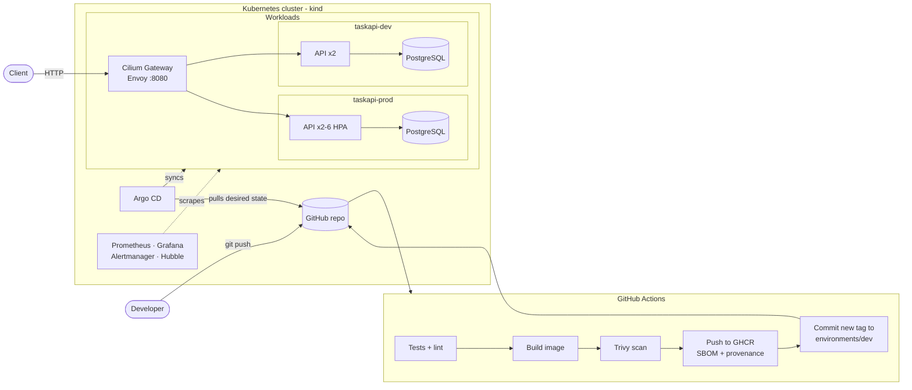
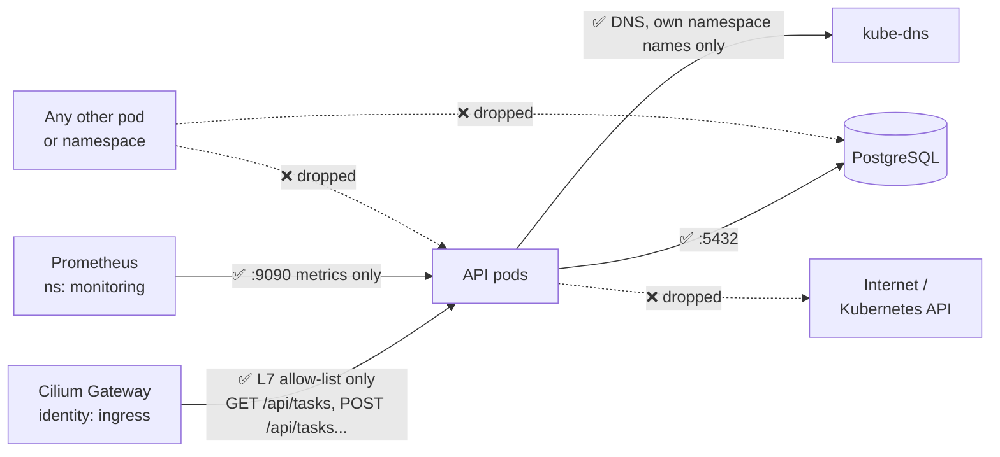
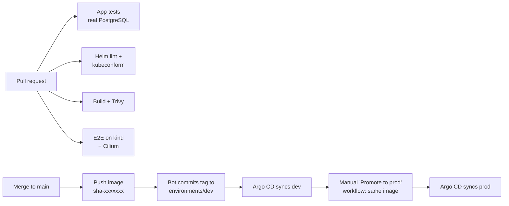

# Zero-Trust GitOps Platform on Kubernetes

[](https://github.com/NadaEhe/k8s-zero-trust-gitops/actions/workflows/ci.yml)
[](https://github.com/NadaEhe/k8s-zero-trust-gitops/actions/workflows/e2e.yml)
[](LICENSE)

A complete, reproducible Kubernetes platform where **Git is the only way to change the cluster** and **no network connection is allowed unless a policy explicitly says so**.

It runs on a laptop with one command (`make up`) and is tested end-to-end on a real cluster in CI for every change.

| | |
|---|---|
| **GitOps** | Argo CD deploys everything from this repository (app-of-apps, sync waves, self-healing, dev → prod promotion). |
| **Zero-trust networking** | Cilium (eBPF) replaces kube-proxy, enforces default-deny, L7 HTTP filtering and DNS-aware egress rules. |
| **Modern ingress** | Kubernetes **Gateway API** (the successor of Ingress) implemented by Cilium's built-in Envoy. |
| **CI/CD** | GitHub Actions: tests on real PostgreSQL, Trivy image scan, SBOM + provenance, kubeconform, e2e tests on kind. |
| **Observability** | Prometheus, Alertmanager, Grafana dashboards as code, Hubble network flow visibility. |
| **Hardening** | Pod Security "restricted", non-root read-only containers, no service-account tokens, actions pinned by SHA. |

---

## Architecture



### Zero-trust network model (per environment namespace)



Everything not drawn with a ✅ is **denied** and visible in Hubble. A `PUT /api/tasks/1` never reaches the application: Envoy answers `403 Access denied` on behalf of the policy.

---

## Tech stack

| Layer | Technology | Version |
|---|---|---|
| Cluster | kind (Kubernetes in Docker) | Kubernetes 1.36.4 |
| CNI, service mesh, gateway | Cilium (eBPF, kube-proxy replacement, Envoy) + Hubble | 1.20.5 |
| Ingress API | Gateway API (standard channel) | v1.6.3 |
| GitOps | Argo CD | v3.6.2 |
| Packaging | Helm | v4 |
| Monitoring | kube-prometheus-stack (Prometheus Operator, Grafana, Alertmanager) | 93.9.0 |
| Application | Python 3.13, FastAPI, PostgreSQL 18 | |
| CI/CD | GitHub Actions, GHCR, Trivy, kubeconform, ShellCheck, Dependabot | |

All versions are pinned in [`scripts/versions.env`](scripts/versions.env), shared by local scripts and CI.

---

## Quick start

### Prerequisites

- **Docker** with at least **6 GB RAM** allocated (Docker Desktop: Settings → Resources)
- [kind](https://kind.sigs.k8s.io/docs/user/quick-start/#installation), [kubectl](https://kubernetes.io/docs/tasks/tools/), [Helm](https://helm.sh/docs/intro/install/) ≥ 3.13, `make`
- Optional: [cilium CLI and hubble CLI](https://docs.cilium.io/en/stable/observability/hubble/setup/)
- On Windows: run everything inside **WSL 2** (Ubuntu) with Docker Desktop's WSL integration enabled

### Run it

```bash
git clone https://github.com/NadaEhe/k8s-zero-trust-gitops.git
cd k8s-zero-trust-gitops
make up          # ~5 min: cluster, Cilium, Argo CD, then Argo CD deploys the rest
make status      # all Argo CD applications should become Synced / Healthy
make test        # end-to-end + zero-trust tests
make passwords   # Argo CD and Grafana admin passwords
```

| URL | What |
|---|---|
| http://argocd.localtest.me:8080 | Argo CD (GitOps state of every app) |
| http://grafana.localtest.me:8080 | Grafana ("TaskAPI - Overview" + Cilium/Hubble dashboards) |
| http://hubble.localtest.me:8080 | Hubble UI (live service map, allowed/denied flows) |
| http://taskapi-dev.localtest.me:8080/api/docs | API, dev environment (Swagger UI) |
| http://taskapi.localtest.me:8080/api/docs | API, prod environment |

`*.localtest.me` is a public DNS name that always resolves to `127.0.0.1`, so no `/etc/hosts` editing is needed.

`make down` deletes everything. Run `make help` for all commands.

---

## Things to try

| Scenario | How | What you see |
|---|---|---|
| **GitOps deploy** | Change `replicaCount` in `environments/dev/values.yaml`, push | Argo CD syncs within a minute, no `kubectl` needed |
| **Drift / self-healing** | `kubectl -n taskapi-dev scale deploy/taskapi --replicas=5` | Argo CD puts it back to the value in Git |
| **L7 policy** | `curl -i -X PUT -H 'Host: taskapi-dev.localtest.me' 127.0.0.1:8080/api/tasks/1` | `403 Access denied` from Envoy; the flow shows as DENIED in Hubble |
| **Lateral movement** | `make test` (policy part) | A pod in another namespace cannot reach the API or the database |
| **Egress lockdown** | The API pod tries to reach `1.1.1.1` or resolve `github.com` | Dropped / DNS refused |
| **Autoscaling** | `make load` then `kubectl -n taskapi-prod get hpa -w` | The HPA adds pods when CPU goes above 70% |
| **Resilience** | Delete an API pod while sending requests | No failed requests (2 replicas, readiness probes, preStop delay, PDB) |
| **Bad deploy + rollback** | Push a non-existent `image.tag` for dev, then `git revert` | New pods fail to pull, old pods keep serving (`maxUnavailable: 0`), Argo CD shows *Degraded*; the revert is the rollback |

---

## CI/CD pipeline



- **[ci.yml](.github/workflows/ci.yml)**: lint and tests (pytest on a real PostgreSQL service container), Helm lint, kubeconform validation of every manifest against Kubernetes and CRD schemas, ShellCheck, image build, Trivy scan (fails on fixable HIGH/CRITICAL, report uploaded to the GitHub Security tab), push to GHCR with SBOM and provenance, then the GitOps commit.
- **[e2e.yml](.github/workflows/e2e.yml)**: creates a real kind cluster with Cilium inside the runner, installs the chart, and runs the same test scripts as `make test`, plus a pod-kill resilience test.
- **[promote.yml](.github/workflows/promote.yml)**: promotes the exact image running in dev to prod ("build once, deploy many"), protected by a GitHub Environment.
- CI never talks to the cluster. It only writes to Git; Argo CD pulls. The cluster needs no inbound access and holds no CI credentials.

---

## Repository layout

```
app/                    FastAPI service, tests, Dockerfile (multi-stage, non-root)
charts/taskapi/         Helm chart: Deployment, StatefulSet, HTTPRoute, HPA, PDB,
                        CiliumNetworkPolicies, ServiceMonitor, PrometheusRule
environments/{dev,prod} Per-environment values (image tag = what is deployed)
gitops/
  root.yaml             The single object applied by hand: the "app of apps"
  apps/                 Argo CD Applications + AppProjects (guardrails)
  platform/             Shared Gateway, platform routes, Grafana dashboards
cluster/                kind cluster and Cilium configuration
bootstrap/              Namespaces (Pod Security labels) and Argo CD install
scripts/                bootstrap, smoke tests, network policy tests, versions
docs/                   Design decisions, runbook, learning guide
```

---

## Security measures

- **Network**: default-deny in and out per namespace; L7 HTTP allow-list at the Gateway → pod hop; DNS egress limited to the namespace's own services; metrics on a separate port only Prometheus can reach; no internet egress.
- **Workloads**: Pod Security Admission `restricted` enforced on app namespaces; non-root UIDs; read-only root filesystem; all Linux capabilities dropped; `seccompProfile: RuntimeDefault`; no service-account token mounted.
- **Deployments**: Argo CD AppProjects restrict each app to its repository, its namespaces and namespaced resources only.
- **Secrets**: generated randomly at bootstrap, never committed to Git.
- **Supply chain**: every GitHub Action pinned to a commit SHA, least-privilege workflow tokens, Trivy scanning, SBOM and provenance attestations, Dependabot updates.

---

## Design decisions and limits

The reasoning behind each choice (Cilium vs. Calico, Gateway API vs. ingress-nginx, Argo CD vs. Flux, pull-based CD, etc.) is in **[docs/decisions.md](docs/decisions.md)**. Incident procedures are in **[docs/runbook.md](docs/runbook.md)**.

This is a lab on kind. A production setup would add: TLS everywhere (cert-manager), a managed database or a PostgreSQL operator (CloudNativePG) with backups, External Secrets Operator or Sealed Secrets instead of bootstrap-created secrets, SSO for Argo CD and Grafana, a log pipeline (Loki), and multiple clusters provisioned with Terraform.

---

## Author

**Neda Bousba**: Master 2 Networks (RES) student at Sorbonne Université, DevOps & network engineering.
[LinkedIn](https://www.linkedin.com/in/neda-bousba-5b55a12b5/)
